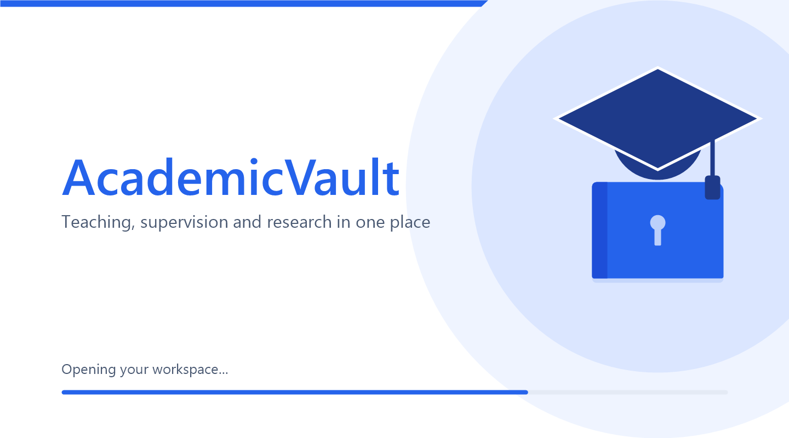

  

<h1 align="center">AcademicVault</h1>

  <b>Teaching, supervision and research in one place.</b> 
  A free Windows desktop application for university teachers. Everything stays on your own computer.

  <a href="../../releases/latest"><b>Download the latest version</b></a>

---

AcademicVault keeps what a university teacher has to look after in one organized, searchable place: your courses and their outcomes, your lecture materials with every version, your timetable, your supervision of student projects, your question banks and papers, and your academic resume. It is made by teachers, for teachers.

## Screenshot

  

## Features

**Teaching**
- Course catalog with learning outcomes (CLOs and their Bloom level), topics, books and course tools
- Teaching materials as lectures with files, and a full version history of every file
- What you teach to each class, term by term, with class representatives (CRs)

**Timetable**
- Weekly timetable per term with a picture of the week by day, venue and time slot
- Clash checks for rooms, classes and courses

**Supervision**
- Projects and research you supervise: students, committee, meetings and visits, defenses, milestones, deliverables, examiner reports and publications
- A timeline for each project and alerts for visits that are due

**Assessments**
- Question topics and a question bank (multiple choice, theory and practical) with answer keys and versions
- Mid, final and quiz papers built from the bank, with Word export of the paper and its answer key
- Assignments, lab tasks, course projects and presentations with learning outcomes and marks

**Resume**
- A structured academic resume: education, employment, papers, books, patents, theses, grants, awards, service, courses taught and supervision
- Several personas (versions of your resume) and Word export

**People**
- External members (examiners, reviewers, co-supervisors), internal members and students, with their details

**Everything else**
- Light and dark colour modes, tooltips on every button and field, a menu you can reorder
- A verified backup of your database before every upgrade and before every update
- Updates that download only what changed, and a What's New page after each update

## Download and install

1. Open the [latest release](../../releases/latest).
2. Download the file whose name ends in `-win-x64-Setup.exe` (for example `AcademicVaultApp-0.1.3-win-x64-Setup.exe`) and run it. No administrator rights are needed; it installs for the current user only.
3. Windows may show an "unknown publisher" warning because the installer is not code-signed yet. Choose **More info**, then **Run anyway**.
4. At the first start, choose a folder. AcademicVault makes a **Data** folder (your database, files and exports) and a **Backups** folder inside it. Choose a folder you look after, for example on a drive that is backed up.

## System requirements

| | |
|---|---|
| **Operating system** | 64-bit Windows 10 (version 1607 or newer) or Windows 11 |
| **Processor type** | 64-bit (x64). There is no 32-bit (x86) version |
| **Disk space** | About 140 MB for the program (the download is about 65 MB), plus room for your own data and backups |
| **Other software** | Nothing to install. The .NET runtime is included, and Microsoft Word is not needed (Word files are written by AcademicVault itself) |
| **Administrator rights** | Not needed. It installs for the current user only |
| **Internet** | Only to download the installer and to check for updates. AcademicVault works fully offline |

## Updates

Each time it starts, an installed copy checks this page for a newer version and **asks before installing anything**. Before an update is installed, AcademicVault makes a verified copy of your database in the Backups folder; if that copy cannot be made, the update is not installed. Your data folder is never touched by an update. You can also check by hand in **Settings > Updates**.

## Your data and privacy

- Your data lives in the folder you chose, on your computer. There is no account, no cloud and no tracking.
- The only network use is the check for a newer version on this page.
- You can move the data and backup folders later in **Settings > Storage folders**.
- Keep your own backups as well; the licence says so.

## What is new

See the [releases](../../releases) for the notes of every version. The same notes are in the application under **System > What's New**.

## Core Team

- **Dr. Qamar Nawaz**, Assistant Professor, University of Agriculture Faisalabad, Pakistan
- **Dr. Isma Hamid**, Assistant Professor, National Textile University Faisalabad, Pakistan

## Licence

AcademicVault is freeware: free to use for personal, academic and institutional purposes, not for sale. It is not open-source software and this repository holds only the downloads. See [LICENSE.txt](LICENSE.txt).

Copyright (c) 2026 Dr. Qamar Nawaz, Department of Computer Science, University of Agriculture Faisalabad, Pakistan. All rights reserved.
